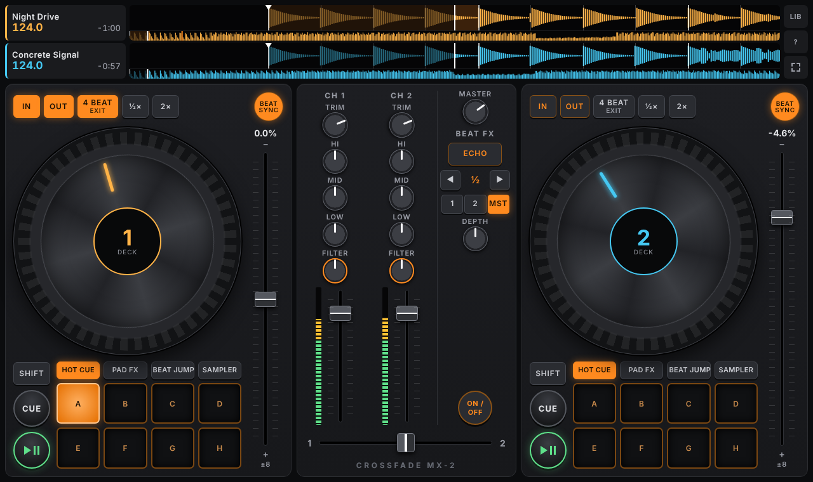

# Crossfade MX-2

A two-deck DJ controller that runs in a web browser. One HTML file, no install, no account, and four built-in tracks to practise with.

**Try it:** [https://YOUR-USERNAME.github.io/YOUR-REPO/ (replace with your GitHub Pages address)](https://martinsolent.github.io/crossfade_dj_app/)

**Watch the one-minute tour:** [crossfade-mx2-promo.mp4](crossfade-mx2-promo.mp4)

> To make the video play inside this README, edit the file on github.com, drag the MP4 into the editor, and GitHub will insert a playable link.

## What it does

- **Two decks** with jog wheels (scratch and nudge), play, cue, beat sync and a tempo fader with ±8, ±16 and ±50% ranges
- **Loops**: manual in and out, one-tap four-beat loop, halve and double
- **Eight pads per deck** in four modes: Hot Cue, Pad FX (loop rolls, echo, reverb, filters), Beat Jump and Sampler
- **Mixer**: trim, three-band EQ and a filter per channel, level meters, channel faders, crossfader and master level
- **Beat FX**: echo, ping pong, reverb and flanger, timed to the beat
- **Waveforms**: scrolling waveforms with beat grids for both decks, plus an overview bar for jumping through a track
- **Four sample tracks**, generated in the browser when the page loads: house (124 BPM), techno (130), hip-hop (90) and drum and bass (174)
- **Your own music**: add MP3, WAV, M4A or OGG files from your device. They never leave it. Tempo is estimated when a file loads
- **Any screen**: side-by-side layout on desktops and large tablets, one panel at a time with a play-and-crossfader dock on phones

## Quick start

1. Open the page.
2. Wait a second or two for "Rendering tracks…" to finish, then press **Start mixing**. Browsers only allow sound after a tap or click, which is why the button is there.
3. Press the green **play** button on Deck 1.

On an iPhone, switch off silent mode or you will hear nothing.

### Use it like an app

| Device | How |
| --- | --- |
| iPhone or iPad (Safari) | Share button, then **Add to Home Screen**. It opens full screen with no browser bars. |
| Android (Chrome) | Menu (⋮), then **Add to Home screen**, or tap the full-screen button in the top-right corner of the page. |
| Desktop | Click the full-screen button in the top-right corner, or press F11. |

## Host it on GitHub Pages

1. Create a repository and upload `index.html`, this `README.md` and the `media` folder.
2. In the repository, open **Settings → Pages**.
3. Under **Build and deployment**, set **Source** to *Deploy from a branch*, choose `main` and `/ (root)`, then **Save**.
4. After a minute the site is live at `https://YOUR-USERNAME.github.io/YOUR-REPO/`. Put that address in the **Try it** line above.

To run it locally, download `index.html` and open it in a browser. The page loads two fonts from Google Fonts; without a connection it falls back to system fonts and everything else still works.

## Beginner tutorial: your first mix

No DJ experience needed. This takes about five minutes. On a phone, use the **Deck 1 / Mixer / Deck 2** tabs at the bottom to switch panels; the play buttons and crossfader stay on screen the whole time.

### 1. Get to know the screen

- **Top:** two waveforms. Orange is Deck 1, blue is Deck 2. The white line in the middle is "now". The thin vertical lines are beats; the brighter ones mark every fourth beat.
- **Left and right:** the decks. Each one plays a track.
- **Middle:** the mixer. It decides how much of each deck you hear.

### 2. Play one track

1. Slide the **crossfader** (the horizontal fader at the bottom of the mixer) all the way left. Now only Deck 1 is heard.
2. Press **play** on Deck 1. "Night Drive" starts and the orange waveform scrolls.
3. Move the **CH 1** fader up and down to hear the volume change, then leave it near the top.

### 3. Match the second track

A mix sounds smooth when both tracks run at the same speed with their beats landing together. That is called beatmatching, and Beat Sync does it for you.

1. Press **play** on Deck 2. You will not hear it yet because the crossfader is fully left.
2. Press **Beat Sync** on Deck 2. Its BPM number changes to match Deck 1 and the beat lines in the two waveforms line up.

### 4. Make the transition

1. Turn the **LOW** knob on CH 2 all the way down. Two bass lines at once sound muddy, so the incoming track starts without its bass.
2. Slowly slide the **crossfader** to the middle. Both tracks are now playing together.
3. Swap the bass: turn CH 1 **LOW** down while you turn CH 2 **LOW** back up to the centre.
4. Slide the crossfader all the way right. You are now playing only Deck 2. That was your first mix.
5. Double-tap CH 1 **LOW** to reset it for next time.

### 5. Load the next track

1. Tap the track name next to the Deck 1 waveform (or the **LIB** button).
2. Choose a track and tap **Deck 1**.
3. Repeat steps 3 and 4 in the other direction.

### 6. Things to try next

- **Loop:** press **4 Beat** to repeat the current four beats. Press it again to carry on. **½×** and **2×** change the loop length.
- **Hot cues:** in **Hot Cue** mode, tap an empty pad to remember that spot in the track. Tap it again any time to jump straight back. Hold **Shift** and tap a pad to clear it.
- **Filter:** turn a **FILTER** knob left to muffle a track or right to thin it out. Sweeping it during a transition is a classic move.
- **Scratch:** drag the centre of a jog wheel back and forth.
- **Sampler:** switch the pads to **Sampler** and tap them for drum hits, a horn and a laser.
- **Echo out:** set Beat FX to **ECHO**, press **ON / OFF**, then pause the track and let the echoes fade.

## Controls reference

### Deck

| Control | What it does |
| --- | --- |
| Play / pause | Starts and stops the track. |
| Cue | Paused: sets the cue point. Paused at the cue point: hold to preview. Playing: jumps back to the cue point and stops. Shift + Cue returns to the start. |
| Jog wheel | Drag the centre to scratch. Drag the outer ring while playing to nudge the beat. Shift + drag searches quickly. |
| Tempo fader | Speeds up (down) or slows down (up). Double-tap to reset. Changing tempo also changes pitch. |
| Beat Sync | Matches tempo and beat to the other deck. Shift + Beat Sync changes the tempo range. |
| In / Out | Set the start and end of a manual loop. |
| 4 Beat / Exit | Starts a four-beat loop, or leaves the current loop. Shift + 4 Beat returns to the last loop. |
| ½× / 2× | Halve or double the loop. |
| Shift | Hold it, or tap to latch it on and tap again to release. |

### Pads

| Mode | Pads |
| --- | --- |
| Hot Cue | Eight stored jump points, A to H. |
| Pad FX | Hold for loop rolls (⅛, ¼, ½, 1 beat), echo, reverb, low-pass and high-pass. The track carries on from where it would have been when you let go of a roll. |
| Beat Jump | Skip back or forward 1, 2, 4 or 16 beats. |
| Sampler | Kick, snare, clap, hat, horn, laser, bell and drop. |

### Mixer

| Control | What it does |
| --- | --- |
| Trim | Input level for the channel. |
| Hi / Mid / Low | Three-band EQ. Fully left cuts the band almost completely. |
| Filter | Left of centre is a low-pass filter, right of centre is a high-pass filter, centre is off. |
| Channel faders | Volume of each deck. |
| Crossfader | Left is Deck 1, right is Deck 2, centre is both. |
| Master | Overall volume. |
| Beat FX | Tap the effect name to change it, use ◀ ▶ for the beat length, choose channel 1, 2 or master, set Depth, then press ON / OFF. |

Double-tap any knob or fader to reset it.

### Keyboard

| Key | Action |
| --- | --- |
| Z / X / S | Deck 1 play, cue, sync |
| M / N / K | Deck 2 play, cue, sync |
| Arrow keys | Adjust the focused knob or fader |

## Limits

- **No headphone cue.** A browser has one audio output, so you cannot pre-listen to a track privately.
- **No key lock.** Changing tempo changes pitch, like a vinyl turntable.
- **Estimated tempo for your own files.** The beat grid can be off for music without a steady beat.
- **Nothing is saved.** Hot cues, loops and added files are gone when you reload the page.
- **Full screen on iPhone** only works through Add to Home Screen.
- Tracks longer than ten minutes play normally but cannot be scratched backwards.

## How it works

Everything is in `index.html`: markup, styles and script, with no build step and no libraries. Sound uses the Web Audio API. The sample tracks and sampler sounds are synthesised in JavaScript when the page loads, so the repository contains no audio files.

## About the video

`media/crossfade-mx2-promo.mp4` is a one-minute tour filmed from the real page. Its soundtrack is the two built-in tracks blended at matched tempo.
